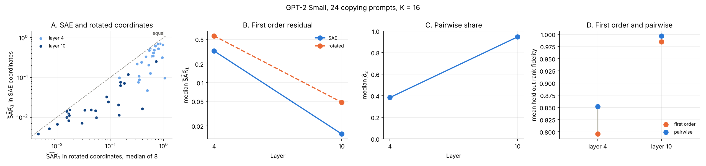

ここ数日このシリーズではエージェントSkillsエコシステム系のツールを続けて検証してきたが、今日は毛色を変えて、解釈可能性(interpretability)分野の論文を1本、実際に手を動かして再現してみる。

## 題材: SAEの特徴は本当に独立して足し算できるのか

題材は "Behavioral Compositionality of Sparse Autoencoder Representations" という論文である([Ziye Mei, Frederic Sala〈University of Wisconsin–Madison〉](https://huggingface.co/papers/2610.21261))。

Sparse Autoencoder(SAE)は、大規模言語モデルの内部表現(残差ストリーム)を、人間にとって解釈しやすい「特徴(feature)」の疎な組み合わせに分解する手法として、ここ数年のinterpretability研究で広く使われている。

SAEの魅力は「個々の特徴に意味があり、それらを足し合わせればモデルの振る舞いを説明できる」という前提にある。たとえば「ある特徴を取り除けば、モデルの出力がその特徴の分だけ変化する」という加算的な直感が、steering(モデルの出力を特定方向に誘導する)などの応用の土台になっている。

この論文は、その加算的な前提を正面から検証する。SAEが選んだ特徴の活性化×デコーダ方向を単純に足し合わせるだけで、実際のモデルの振る舞いをどれだけ説明できるか(逆に言えば、どれだけ説明できずに残差として残るか)を "SAE Additivity Residuals(SAR)" という指標で定量化している。

筆者が面白いと思ったのは比較の対象である。学習済みSAEの座標系を、**同じ部分空間のランダムな直交回転**と比較する。回転は「足し算」という操作そのものは保存するが、各座標が意味のある特徴であるという保証は失う対照群になる。論文は18種類のモデル・振る舞いの組み合わせ全てで、学習済み座標系の方がランダム回転よりも1次(個々の特徴のみ)残差が小さいことを示し、さらに2次(特徴ペア)の交互作用を加えるとsteering実験の精度(rank fidelity)が0.5874から0.7790まで改善したと報告している。つまり「SAEの特徴は、ある程度は足し算で説明できるが、完全な足し算ではない」という主張である。

## 検証の方針: GPT-2 Small限定の縮小再現

論文本体の評価はGemma Scope 2やLlama ScopeなどのSAEを使い、Gemma-3やLlama-3.1 8Bを含む大型モデルが対象で、フル再現にはGPUが前提になる可能性が高い。

一方で、著者らが公開しているコード([OpenSAE/SAE-Behavioral-Compositionality](https://github.com/OpenSAE/SAE-Behavioral-Compositionality)、Apache-2.0)には、GPT-2 Small + 公開済みのSAE(`gpt2-small-res-jb`)で動く縮小デモ(`demo/demo.py`)が同梱されている。そこで今回は、このデモをそのままCPUのみで実行し、「学習済みSAE座標 vs ランダム回転」の1次残差比較を実際に再現することに絞った。2次の交互作用やsteering実験のrank fidelity(論文本体の0.5874→0.7790)の完全な再現はスコープ外とした。

デモは、GPT-2 Smallの残差ストリームにSAEを噛ませ、"Alice Emma Alice" のような「A B A→Bと続くはず」のコピー型プロンプト24個に対して、上位16特徴の寄与をランダムに384通り(256個で学習・128個を保留してホールドアウト評価)の組み合わせで残したり消したりしながら、実際のモデルの出力(`logit(B) - logit(C)`)との誤差を測るという仕組みになっている。

## 実際に動かした結果

Python 3.11・CPUのみの環境で、GPT-2 Smallのlayer 4とlayer 10についてこのデモを実行した。実行時間は約4分13秒で、追加の有料APIキーもGPUも不要だった。

```
$ python3 demo/demo.py --layers 4 10
Loaded pretrained model gpt2 into HookedTransformer
layer  4 done
layer 10 done

GPT-2 Small, 24 copying prompts, K = 16, 384 coalitions (256 fit, 128 held out)

Layer  SAR_1 SAE  SAR_1 rotated  SAE lower   rho_2  affine SAR_1
    4     0.3232         0.5652     24 / 24   0.383       2.3e-27
   10     0.0148         0.0481     24 / 24   0.945       5.3e-26
```

layer 4では、SAE座標の1次残差(SAR_1)が0.3232だったのに対し、同じ部分空間のランダム回転(8回の中央値)は0.5652で、**24プロンプト全てでSAE座標の方が残差が小さかった**。layer 10でも同様に0.0148 対 0.0481で、やはり24/24でSAE座標が下回った。

実際に生成された図がこちらである(左から、各プロンプトごとのSAE座標 vs 回転座標の散布図、層ごとの1次残差の推移、ペア交互作用の寄与率、held-outでのrank fidelity)。


<!-- 公開時はZennエディタで画像をアップロードし、このパスをZennのCDN URLに差し替えてください -->

layerが深くなるほど(4→10)残差自体が小さくなっており(0.32→0.015)、後段の層ほど振る舞いが足し算的に説明しやすくなる傾向も確認できた。また、サニティチェックとして線形写像のみを使うアフィン制御を計算すると、layer 4・10ともにSAR_1は2.3e-27、5.3e-26とほぼ完全に0になり、今回の実行パイプライン自体が数値的に健全であることも確かめられた。

ρ₂(2次の交互作用を加えるとSAR_1のうちどれだけ追加で説明できるか)はlayer 4で0.383、layer 10で0.945だった。1次だけでもランダム回転より明確に優れているが、2次を足すとさらに説明力が上がるという、論文の「完全な足し算ではない」という主張の方向性も、GPT-2 Small・2層限定ながら確認できた。

**ここで強調しておきたいのは、これらの数値は論文本体の集計値(18種類のモデル・振る舞いの組み合わせ、rank fidelity 0.5874→0.7790)とは別物だということである。** 今回はリポジトリ同梱のGPT-2 Small限定デモをそのまま動かしただけで、大型モデルでの評価は含まれていない。それでも、「学習済みSAE座標の方がランダム回転よりも振る舞いを足し算的に説明できる」という論文の中心的な主張の骨格は、CPUのみ・数分という手元の環境で確かに再現できた。

## つまずいた点

公式の`requirements_demo.txt`は`numpy==2.5.0`を固定しているが、これはPython 3.12以降が前提のバージョンで、今回使ったPython 3.11環境ではインストールできなかった(`requirements_demo.txt`のコメント自体に「Python 3.12.10で動作確認」と明記されている)。バージョン指定を外して最新の互換版(numpy 2.4.6)を入れ直すと問題なく動いた。

## 追加検証: 自分のPCのGPUで再実行してみた

CPUだけでも十分動いたとはいえ、「GPUを使ったら結果は変わるのか、速くなるのか」が気になったので、自分のローカルPC(WSL2 Ubuntu、NVIDIA GeForce RTX 5060 Ti、16GB VRAM)でも同じデモをそのまま再実行してみた。ローカルはPython 3.12が入っていたので、今度は`requirements_demo.txt`の固定バージョン(`numpy==2.5.0`・`torch==2.11.0`など)を一切変更せずそのままインストールでき、`torch.cuda.is_available()`が`True`を返してGPUが使われていることも確認できた。

```
$ python3 -c "import torch; print(torch.__version__, torch.cuda.is_available(), torch.cuda.get_device_name(0))"
2.11.0+cu130 True NVIDIA GeForce RTX 5060 Ti

$ time python3 demo/demo.py --layers 4 10
Layer  SAR_1 SAE  SAR_1 rotated  SAE lower   rho_2  affine SAR_1
    4     0.3232         0.5652     24 / 24   0.383       2.6e-27
   10     0.0148         0.0481     24 / 24   0.945       7.1e-26

real    1m0.801s
```

結果から言うと、**SAR_1・rotated・SAE lowerの比率・ρ₂・rank fidelityまで、報告される桁数ではCPU版と完全に一致した**。`affine SAR_1`のような理論上0になるはずの量にだけ、GPU特有の浮動小数誤差(e-27〜e-26オーダー)の違いが出たが、実質的には誤差の範囲内である。一方で実行時間は4分13秒から1分1秒まで短縮され、約4.2倍速かった。

地味な発見だが、これも今回の検証にとって無視できない点だと思う。CPU環境でつまずいた「`numpy==2.5.0`が入らない」という問題は、ツールのバグではなく、こちらの環境(Python 3.11)が公式の前提(Python 3.12)からズレていたことが原因で、Python 3.12・GPUが揃ったローカル環境では何の対処もなくそのまま動いた。環境を変えても主張の中身(学習済みSAE座標の優位性)は変わらない、という再現性の高さを別の角度から確認できたのは収穫だった。

## まとめ

- `OpenSAE/SAE-Behavioral-Compositionality`(Apache-2.0)は、GPU・有料APIキーなしでも、CPUのみ・4分程度で「SAEの学習済み座標はランダム回転よりも振る舞いを足し算的に説明できる」という論文の中心的主張を再現できた。
- Python 3.11環境では公式の固定バージョン(`numpy==2.5.0`)がそのままでは入らない点に注意が必要(Python 3.12前提と明記されている)。実際、Python 3.12・GPUのローカル環境では固定バージョンのままで何も手を加えずに動いた。
- ローカルPCのGPU(RTX 5060 Ti)で追加検証したところ、主要な数値はCPU版と完全に一致し、実行時間は約4.2倍(4分13秒→1分1秒)短縮された。環境(CPU/GPU、Python 3.11/3.12)が変わっても結論は揺るがない、という再現性を確認できた。
- 今回はGPT-2 Small・2層・24プロンプトという縮小スケールでの再現であり、論文本体の大型モデルでの集計値とは別物である点は留意してほしい。

出典・ライセンス: 論文は[https://huggingface.co/papers/2610.21261](https://huggingface.co/papers/2610.21261)、コードは[OpenSAE/SAE-Behavioral-Compositionality](https://github.com/OpenSAE/SAE-Behavioral-Compositionality)(Apache-2.0)。今回使用した`sar.py`・`demo/demo.py`は無改変でそのまま取り込んでいる。検証コード・実行ログの全文は[GitHubリポジトリのexperiments/day-020](https://github.com/Matsushima-A-830/ai-100days/tree/main/experiments/day-020)を参照。
