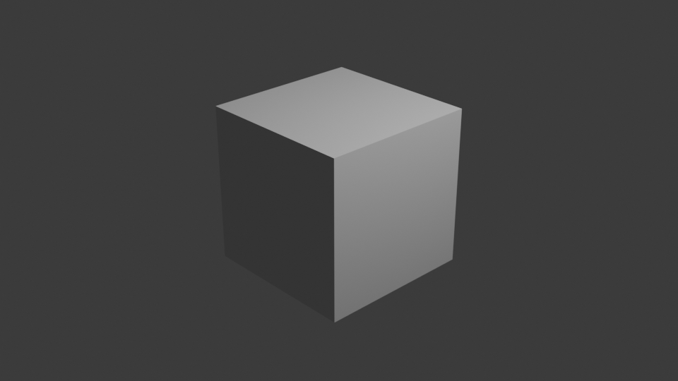
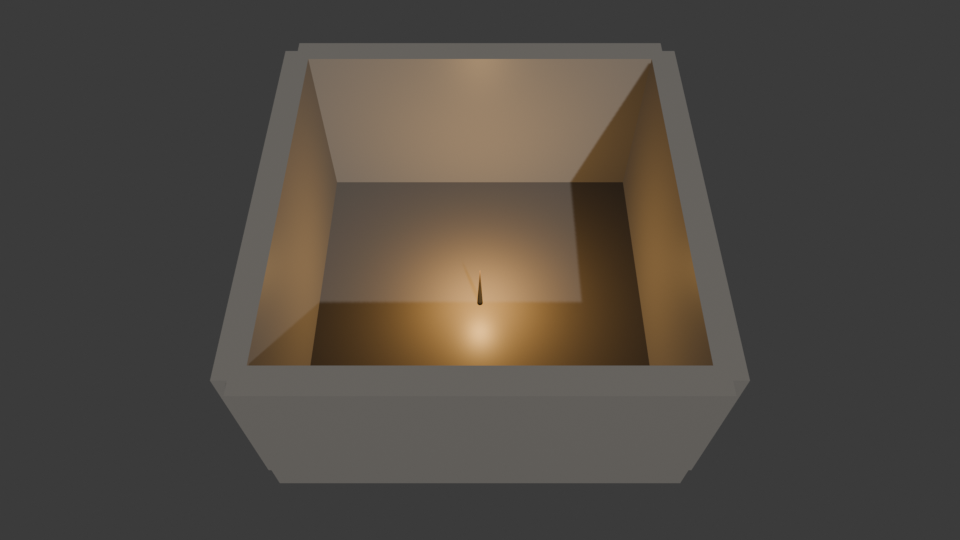

本日のGitHub Trending(Python/全言語)で+2,098star/日という伸びを見せていた[ahujasid/mcp-for-blender](https://github.com/ahujasid/mcp-for-blender)(MIT License、旧称`blender-mcp`)を実際に手元の環境で動かしてみた。

AIクライアント(Claude Desktop/Claude Code等)からModel Context Protocol(MCP)経由でBlenderのPython API(`bpy`)を直接実行させ、シーン作成・アセット取り込み・3Dモデル生成を自然言語で行えるというツールである。筆者はBlenderのGUI操作にあまり詳しくないが、「日本語で指示するだけでBlenderに何かを作らせられる」という体験がどこまで本当なのか、実際に検証してみた。

## 前提: この記事で検証した範囲

- Poly Haven等の無料アセット連携は対象外(時間の都合でシーン生成のコア動作確認を優先した)
- Sketchfab/Hyper3D/Meshy/Tripo等、APIキーが必要な有料3D生成連携は最初から対象外
- GPUは未使用(Blender 4.0.2のEEVEEレンダラーをCPUで実行)

追加の有料APIキーなしで、Blender 3.0+・Python 3.10+・`uv`さえあれば検証できる範囲に絞っている。

## まずBlenderが無い環境から始まった

検証環境にBlenderが入っていなかったので、まずインストールした。

```
$ apt-get install -y blender
$ blender --background --version
Blender 4.0.2
```

mcp-for-blenderのアドオン(`addon.py`)を有効化しようとすると、`requests`モジュールが見つからずに失敗した。

```
ModuleNotFoundError: No module named 'requests'
```

配布パッケージ版のBlenderは`requests`を同梱していないことがある。Blenderが使うPythonのパスに向けて明示的にインストールし直すことで解決した。

```
$ python3.12 -m pip install --target ~/.config/blender/4.0/scripts/addons/modules requests
```

## ハマりポイント: `blender --background`では動かない

次に`blender --background`(ヘッドレスモード)でアドオンを有効化してみたが、ソケットサーバー自体が起動しなかった。アドオンのソースコードを読むと、これは意図された仕様だとわかる。

```python
def start(self):
    if bpy.app.background:
        print("BlenderMCP: cannot start server in background mode (blender -b) - commands would never execute\n"
              "BlenderMCP: run Blender with a GUI, or use a virtual display: xvfb-run -a blender")
        return
```

MCPサーバー側のタイムアウトメッセージにも同じ助言が書かれている。

```
If Blender is running headless (blender -b), commands never execute;
run Blender with a GUI or via 'xvfb-run -a blender' instead
```

つまりツール自身が「GUIなしサーバーで動かしたいなら仮想ディスプレイ(Xvfb)を使え」と明示的に案内している。これに従い、`xvfb-run -a blender`でBlenderを(GUIモードのまま)仮想ディスプレイ上で起動したところ、アドオンのソケットサーバーが正常に立ち上がった。

```
$ nohup xvfb-run -a blender > blender_gui.log 2>&1 &
$ cat blender_gui.log
BlenderMCP addon registered
Server thread started
BlenderMCP server started on localhost:9876
```

生のTCPソケットで疎通確認すると、デフォルトシーン(Cube/Light/Camera)の情報が正しく返ってきた。

```
$ python3 -c "
import socket, json
s = socket.socket(socket.AF_INET, socket.SOCK_STREAM)
s.connect(('localhost', 9876))
s.sendall(json.dumps({'type': 'get_scene_info', 'params': {}}).encode('utf-8'))
print(s.recv(8192).decode())
"
{"status": "success", "result": {"name": "Scene", "object_count": 3,
  "objects": [{"name": "Cube", ...}, {"name": "Light", ...}, {"name": "Camera", ...}]}}
```

## 実際にMCPクライアントとして繋いでみる

この検証環境にはClaude Desktop等のGUIクライアントが無いため、Pythonの`mcp`パッケージ(`stdio_client`/`ClientSession`)で簡易MCPクライアントを自作し、`uv run mcp-for-blender`をstdio経由のMCPサーバーとして起動して実際にMCPプロトコルで接続した。

```python
from mcp import ClientSession, StdioServerParameters
from mcp.client.stdio import stdio_client

server_params = StdioServerParameters(command="uv", args=["run", "mcp-for-blender"], cwd="mcp-for-blender")
async with stdio_client(server_params) as (read, write):
    async with ClientSession(read, write) as session:
        await session.initialize()
        tools = await session.list_tools()
```

公開されているツール一覧はこの通りだった。

```
['disable_telemetry', 'execute_blender_code', 'generate_3d', 'get_addon_status',
 'get_scene_info', 'import_asset', 'look', 'record_trajectory_feedback', 'search_assets']
```

## 日本語の指示でシーンを作らせる

以下の日本語指示を`user_prompt`として渡し、`execute_blender_code`ツールでBlender Pythonコード(壁4枚・床・松明・カメラを配置するコード)を実行させた。

> 低ポリゴンのダンジョンシーンを作って。石の壁で囲まれた部屋と、中央に松明を1本置いて、カメラで部屋全体が見えるようにレンダリングして。

実行前の`get_scene_info`はデフォルトシーンのまま。

```
Scene 'Scene' | 1 camera, 1 light, 1 mesh | active Cube | selected Cube | mode OBJECT
Cube | mesh | at (0.0, 0.0, 0.0) | size 2.0x2.0x2.0
```

`execute_blender_code`を実行すると、こう返ってきた。

```
Code executed successfully: SCENE_BUILD_RESULT:{'object_count': 8, 'object_names':
['Floor', 'RoomCamera', 'Torch_Flame_Light', 'Torch_Handle', 'Wall_East', 'Wall_North',
'Wall_South', 'Wall_West']}
```

実行後の`get_scene_info`では、指示通り壁4枚・床・松明(柄+暖色の点光源)・カメラが揃っていることをMCP経由のテキスト応答だけで確認できた。

```
Scene 'Scene' | 1 camera, 1 light, 6 mesh | active RoomCamera | selected RoomCamera | mode OBJECT
Wall_North | mesh | at (0.0, 3.0, 1.5) | size 6.0x0.4x3.0
Wall_South | mesh | at (0.0, -3.0, 1.5) | size 6.0x0.4x3.0
Wall_East | mesh | at (3.0, 0.0, 1.5) | size 0.4x6.0x3.0
Wall_West | mesh | at (-3.0, 0.0, 1.5) | size 0.4x6.0x3.0
Floor | mesh | at (0.0, 0.0, 0.0) | size 6.0x6.0x0.0
```

## Before/Afterのレンダリング画像

`execute_blender_code`内で`bpy.ops.render.render(write_still=True)`を呼べば、MCP経由でBlenderのレンダリング結果を画像ファイルとして保存できる。デフォルトシーンと、日本語指示で生成した後のシーンをそれぞれレンダリングした。

Before(デフォルトのCubeシーン):



After(日本語指示で生成した石壁の部屋+松明):



余談だが、カメラの初期配置(部屋の外から水平に狙う位置)では、厚み0.4のソリッドな壁がカメラと室内の間を完全に塞いでしまい、無地のグレー画像になってしまった。これは筆者のシーン構築コード側のカメラ配置ミスであり、ツール自体の不具合ではない。天井の無い部屋を上空から見下ろすアングルに置き直したところ、上記のAfter画像のように室内と松明の光が映るようになった。同じソケット接続上で何度でもコードを再実行・再レンダリングできる手軽さも確認できた。

## まとめ

- `mcp-for-blender`の「MCPクライアント→MCPサーバー→Blenderアドオン→`bpy`実行」という全スタックは、GPUや有料APIキーなしのLinuxサーバー環境でも、Xvfb経由であれば実際に動作した。
- `blender --background`では動かないが、これはツール側が意図的に拒否する仕様であり、エラーメッセージ・ソースコード双方が`xvfb-run -a blender`を公式な代替手段として明記していた。ツールの案内に従うだけで解決できる種類の制約である。
- 日本語の自然文の指示から、MCP経由でBlenderのシーン(オブジェクト・マテリアル・ライト・カメラ)を実際に変更でき、レンダリング画像として結果を確認できた。

今回はClaude Desktop等の実際のGUIクライアントの代わりにPythonの自作MCPクライアントで検証したが、スタック自体がきちんと動くことは確認できた。Poly Havenのアセット取り込みや、実際のAIクライアントGUIからの操作感については、今後別の機会に試してみたい。

## 出典

- リポジトリ: https://github.com/ahujasid/mcp-for-blender (MIT License)
- PyPI: https://pypi.org/project/mcp-for-blender/
