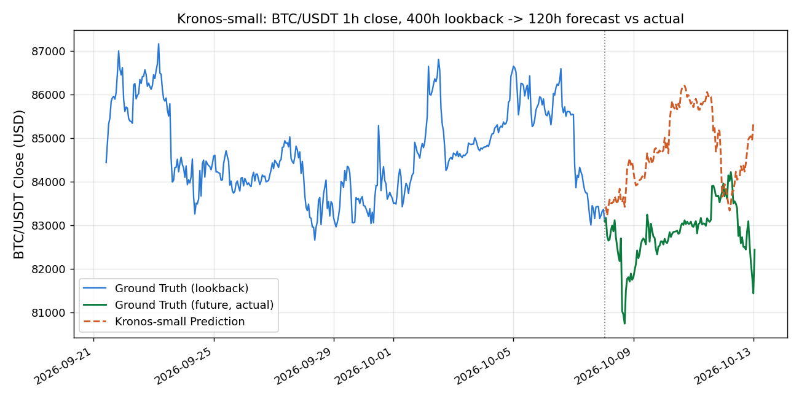

AAAI 2026に採択された金融ローソク足(K線)専用の基盤モデル「Kronos」を、実際にBTC/USDTの1時間足データで動かし、予測結果を実際の値動きと突き合わせてみた。結論から言うと、CPUだけでも十分実用的な速度で動く一方、方向性(上がるか下がるか)の予測力については、今回の検証範囲ではコイン投げ程度にとどまった。

## Kronosとは何か

[Kronos](https://github.com/shiyu-coder/Kronos)は、世界45取引所・120億件超のK線(OHLCV)データで事前学習した、金融ローソク足専用の基盤モデルである([論文](https://arxiv.org/abs/2508.02739)、MIT License)。専用トークナイザがOHLCVを階層的な離散トークンに変換し、自己回帰Transformerがそのトークン列を学習するという2段構成で、一般的な時系列基盤モデルよりも高いゼロショット予測性能(RankIC)を報告している。

モデルは4.1M(Kronos-mini)・24.7M(Kronos-small)・102.3M(Kronos-base)の3サイズがHugging Face Hubで公開されており、499.2MのKronos-largeのみ非公開。今回はKronos-miniでCPUでの実用性を確認したあと、READMEの公式サンプルと同じKronos-smallで本検証を行った。

## 検証の方針

有料APIキーは一切使わない方針なので、価格データはBinanceの公開REST API(APIキー不要)からBTC/USDTの1時間足を700本取得した。モデルに過去400時間分の実績を渡し、未来120時間分を予測させる。幸い、データ取得時点で既にその120時間分の実際の値動きも手元にあるので、予測結果と実績をそのまま突き合わせられる(バックテスト形式)。

```bash
curl -s "https://api.binance.com/api/v3/klines?symbol=BTCUSDT&interval=1h&limit=700" -o btcusdt_1h.json
```

## まずCPUでの実用性を確認する

着手前に気になっていたのは、「GPUが無いノートPC級の環境でも実用的な速度で動くのか」という点だった。最小モデルのKronos-miniで、GPUを明示的に隠した状態(`CUDA_VISIBLE_DEVICES=""`)のCPU推論を試した。

```
$ CUDA_VISIBLE_DEVICES="" python3 cpu_feasibility_test.py
Load time: 7.1s
100%|██████████| 24/24 [00:00<00:00, 78.78it/s]
CPU predict time (Kronos-mini, lookback=200, pred_len=24): 0.3s
```

モデルの読み込み(初回はHugging Face Hubからのダウンロードを含めて約7秒)を除けば、推論自体は0.3秒で終わった。「GPUが無いと話にならない」という懸念は杞憂だった。

## Kronos-smallで本検証: 400時間→120時間予測

公式READMEのサンプル構成(lookback=400, pred_len=120, T=1.0, top_p=0.9, sample_count=1)に合わせ、CPUとGPU(RTX 5060 Ti)の両方で実行した。

```
$ python3 main_run.py --device cpu --out cpu
PREDICT_TIME: 19.62s

$ python3 main_run.py --device cuda:0 --out gpu
PREDICT_TIME: 2.80s
```

| 項目 | CPU | GPU |
| --- | --- | --- |
| 実行時間 | 19.62秒 | 2.80秒(約7倍速) |
| MAE(平均絶対誤差) | $1928.37 | $1929.82 |
| MAPE | 2.33% | 2.33% |
| 方向性的中率(120ステップ中) | 46.7%(56/120) | 50.0%(60/120) |
| 予測差分と実績差分の相関係数 | 0.034 | 0.043 |

CPUとGPUで予測時間には約7倍の差があったが、MAE・MAPEはほぼ同じだった(サンプリングを伴う生成なので、デバイス差というより毎回の乱数の揺らぎの範囲と見られる)。

実際の値動きと予測を重ねたグラフがこちらである。



400時間分の実績(青線)に続き、実際の値動き(緑線)は一度下落してから回復したのに対し、Kronosの予測(オレンジ点線)はほぼ一貫して上昇方向にずれていった。MAPE 2.33%という数字だけ見ると「そこそこ近い」ようにも見えるが、方向性的中率は46.7%〜50.0%と、コイン投げ(50%)を明確に上回ることはなく、予測差分と実績差分の相関係数も0.03〜0.04とほぼ0に近かった。少なくとも今回のBTC/USDT・この120時間という1つの窓では、方向性に関して統計的に意味のある予測力は確認できなかった。

## 複数サンプルの平均(sample_count)は救ってくれるか

論文・READMEでは、`sample_count`を増やして複数の予測パスを平均するとより安定した予測が得られるとされている。GPUなら`sample_count=10`でも5.2秒程度なので、実際に試してみた。

```
$ python3 sample_count_test.py
{
  "predict_time_sec": 5.16,
  "mae_usd": 1891.23,
  "mape_pct": 2.29,
  "directional_accuracy": 0.45,
  "diff_correlation": -0.116
}
```

MAE・MAPEはほぼ変わらず(わずかに改善)、**方向性的中率はむしろ45.0%に下がり、相関係数も-0.116とマイナスに転じた**。少なくとも今回の1回の試行では、サンプル数を増やす平均化が方向性の予測力を改善する効果は確認できなかった。

## まとめ

- Kronosの「データ準備 → トークナイザ → モデル推論」という一連の流れは、追加の有料APIキー不要・GPU不要で、実際のBTC/USDTデータに対して問題なく動作した。公式README通りの依存バージョンで、Python 3.12環境でもインストールトラブルは無かった。
- CPUのみでも実用的な速度で動く。Kronos-miniなら200時間→24時間予測が0.3秒、Kronos-smallの400時間→120時間予測でも約20秒で完了し、GPU(RTX 5060 Ti)を使うと約7倍速くなった。
- 一方で、今回の実測では、価格の方向性を当てる力は確認できなかった。方向性的中率は46.7%〜50.0%でコイン投げ水準にとどまり、`sample_count`を増やしても改善しなかった。
- MAE・MAPE自体は2.3%程度とそこそこ小さいが、これは市場全体の値動きのレンジに自然に追従しているだけで、投資判断に使える方向性のシグナルとは別物である点に注意したい。
- 公式の免責の通り、Kronosの出力は確率的なサンプルの1つであり、これ単体を投資判断の根拠にすべきではない。今回の1回・1銘柄・1期間の検証結果も、他の銘柄・期間では異なる結果になりうる。

## 出典・ライセンス

- リポジトリ: https://github.com/shiyu-coder/Kronos (MIT License)
- 論文: https://arxiv.org/abs/2508.02739 (AAAI 2026)
- 価格データ: Binance Public API (https://api.binance.com)
- 検証コード・実行ログの全文は[GitHubリポジトリのexperiments/day-022](https://github.com/Matsushima-A-830/ai-100days/tree/main/experiments/day-022)を参照。
